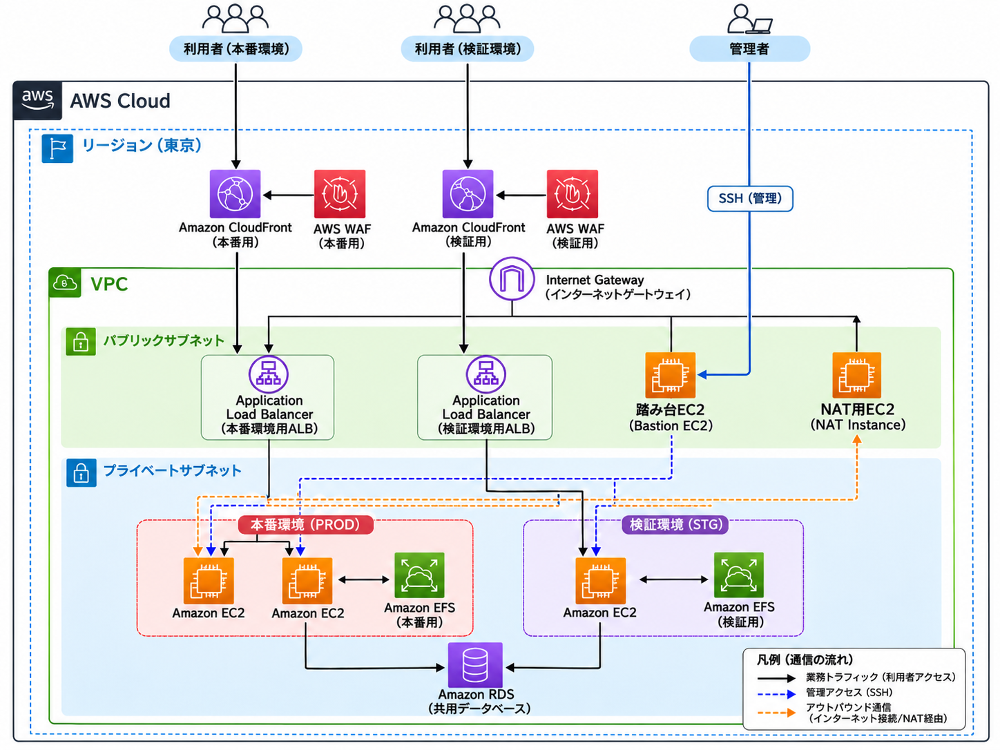
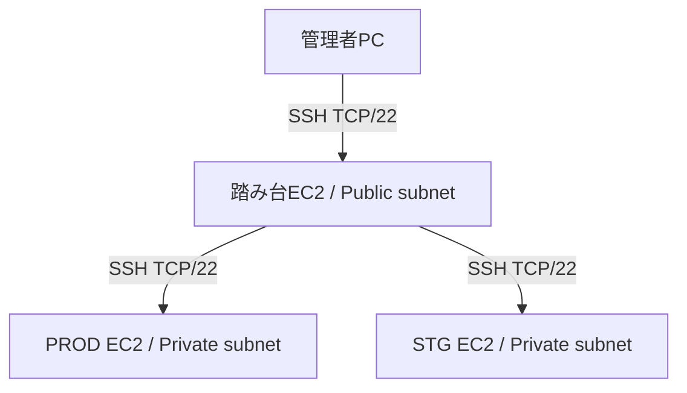

# AWS構成・構築手順書（NAT用EC2版）

## 1. 目的と前提

ホワイトボードに記載されたAWS構成をもとに、**踏み台サーバーをEC2（Bastion EC2）で構築**する場合の構成と、推奨する構築順序を整理する。

- 1つのVPC内に本番（PROD）とステージング（STG）を配置する。
- PROD・STGそれぞれにCloudFront、ALB、アプリケーションEC2、EFSを配置する。
- CloudFrontにAWS WAFを関連付ける構成を想定する。
- アプリケーションEC2はプライベートサブネットに配置する。
- 踏み台用EC2はパブリックサブネットに配置し、管理者のSSH接続経路とする。
- NAT Gatewayは使用せず、**パブリックサブネット上のNAT用EC2（NAT Instance）**を使い、プライベートサブネット内のEC2の外向き通信を可能にする。踏み台EC2とは別インスタンスとして構築する。
- RDSは画像上では共通の1台として描かれているが、**本番とSTGのデータ分離方法は要確認**とする。

> **注意：** 本文のインスタンスタイプ、台数、IPアドレス、サブネットは、画像で確認できた情報と設計例を区別して記載する。最終構成は要件に合わせて確定する。

## 2. AWS全体構成図（顧客提出用）

以下は、現時点で判明している要件から作成した**論理環境構成図**です。CloudFront・WAF、VPC、パブリック／プライベートサブネット、本番・STG環境、踏み台EC2の配置と通信経路を示しています。



- [PNG画像](aws東京リージョン_natインスタンス構成図.png)

### 構成図の見方

| 区分 | 内容 |
|---|---|
| Webアクセス | 利用者 → CloudFront（WAF） → ALB → アプリEC2 |
| ファイル共有 | アプリEC2 → 環境別EFS |
| DB接続 | 本番／STG EC2 → RDS（共用・分離方法は未確定） |
| 管理者アクセス | 管理者 → パブリックサブネット上の踏み台EC2 → 本番／STGのEC2 |
| インターネットへの外向き通信 | プライベートサブネット上のEC2 → NAT用EC2 → Internet Gateway |

**未確定事項・設計上の注意**

- PRODのEC2台数は画像に「2台？」と記載があるため、**1〜2台（要確認）**と表示しています。
- RDSは画像では共有の1台として描かれていますが、**PROD／STGの分離方式は未確定**です。環境別インスタンスまたは少なくともDB・アカウント分離を検討します。
- 図は論理構成であり、**複数AZへの展開、EFSマウントターゲット、ALB配置サブネット数、NAT用EC2の冗長化、セキュリティグループの詳細は省略**しています。
- 踏み台EC2はパブリックサブネットに置き、SSH接続元を管理者の許可IPに限定する想定です。
- WAFはCloudFrontへ関連付ける想定です。CloudFrontからALBへの直接アクセス制御等は詳細設計で決定します。

## 3. サービス構成一覧

| 環境 | サービス | 構成・サイズ | 用途・備考 |
|---|---|---|---|
| 共通 | VPC | 1つ | ネットワーク基盤 |
| 共通 | 踏み台EC2 | t3.micro（仮） | 管理アクセス、Public subnet |
| 共通 | **NAT用EC2（NAT Instance）** | EC2 × 1（暫定）、インスタンスタイプ要決定 | Public subnetに配置。IP転送、NAT、ルーティングを設定 |
| PROD | CloudFront | 1ディストリビューション | 本番Web配信 |
| PROD | WAF | 1 Web ACL（例） | 本番CloudFrontの保護 |
| PROD | ALB | 1つ | 本番EC2への振り分け |
| PROD | EC2 | t3.small × 1〜2（要確認） | 本番アプリケーション |
| PROD | EFS | 1ファイルシステム | 本番用共有ファイル |
| STG | CloudFront | 1ディストリビューション | STG Web配信 |
| STG | WAF | 1 Web ACL（例） | STG CloudFrontの保護 |
| STG | ALB | 1つ | STG EC2への振り分け |
| STG | EC2 | t3.small × 1 | STGアプリケーション |
| STG | EFS | 1ファイルシステム | STG用共有ファイル |
| 共通（要確認） | RDS | db.t4g.small | データベース。共用・分離は要決定 |

## 4. 踏み台EC2の構成

管理者がインターネットから踏み台EC2へSSH接続し、その踏み台を経由してPrivate subnetのPROD／STG EC2にアクセスする。



### セキュリティグループ例

| 接続先 | ポート | 接続元 |
|---|---|---|
| 踏み台EC2 | TCP 22 | 管理者の固定グローバルIPのみ |
| PROD EC2 | TCP 22 | 踏み台EC2のセキュリティグループ |
| STG EC2 | TCP 22 | 踏み台EC2のセキュリティグループ |
| PROD EC2 | TCP 80など | PROD ALBのセキュリティグループ |
| STG EC2 | TCP 80など | STG ALBのセキュリティグループ |
| RDS（MySQLの場合） | TCP 3306 | 許可するアプリEC2のセキュリティグループ |
| EFS | TCP 2049 | 対応するアプリEC2のセキュリティグループ |

- 踏み台のSSHを全インターネット（`0.0.0.0/0`）に公開しない。
- SSHは `ProxyJump` の利用などにより、秘密鍵を踏み台内へコピーしない運用を推奨。
- 踏み台EC2にはセキュリティ更新、監視、不要ポートの閉鎖を実施する。

## 5. ネットワーク設計例

VPC CIDRの例：`10.0.0.0/16`

| サブネット | CIDR例 | 用途 |
|---|---|---|
| Public-A | `10.0.1.0/24` | ALB、踏み台EC2、NAT用EC2 |
| Public-C | `10.0.2.0/24` | ALB、必要に応じ冗長NAT用EC2 |
| Private-App-A | `10.0.11.0/24` | PROD EC2など |
| Private-App-C | `10.0.12.0/24` | PROD/STG EC2など |
| Private-DB-A | `10.0.21.0/24` | RDS用サブネット |
| Private-DB-C | `10.0.22.0/24` | RDS用サブネット |

> これはあくまでCIDRの例。PRODとSTGの分離要件や既存ネットワークとの重複を確認して確定する。表中のA/Cは別々のAZを表す例。

## 6. 構築する順番（NAT用EC2版）

**構築方針：** VPC・Publicネットワーク → 踏み台EC2 → **NAT用EC2** → Privateルート → RDS/EFS → STG → PRODの順とする。NAT用EC2は踏み台EC2とは別のEC2インスタンスとし、混在させない。

| No. | 作業 | 実施内容・確認事項 |
|---:|---|---|
| 1 | 基本設計確定 | リージョン、AZ、CIDR、PROD台数、DB分離、NAT用EC2のサイズを確定 |
| 2 | VPC作成 | CIDR・DNSホスト名・DNS解決を設定 |
| 3 | サブネット作成 | Public / Private-App / Private-DBを複数AZに作成 |
| 4 | Internet Gateway作成 | VPCへアタッチ |
| 5 | Publicルート設定 | `0.0.0.0/0 → Internet Gateway`、Publicサブネットへ関連付け |
| 6 | セキュリティグループ作成 | 踏み台、**NAT用EC2**、ALB、アプリ、EFS、RDS用を作成 |
| 7 | IAM・管理アクセス準備 | IAMロール、SSH鍵、管理者の固定IPを用意 |
| 8 | 踏み台EC2作成 | Publicサブネットへ配置。管理者からのSSH疎通確認 |
| 9 | 踏み台EC2のEIP設定 | 必要に応じElastic IPを割り当て、SSH許可元を限定 |
| 10 | **NAT用EC2作成** | Amazon Linux 2023等のサポート中のOSでPublicサブネットに構築 |
| 11 | **NAT用EC2へEIP割り当て** | Elastic IP付与、Publicルート・外部通信を確認 |
| 12 | **送信元/送信先チェック無効化** | NAT用EC2のSource/Destination Checkを無効にする |
| 13 | **IPv4転送有効化** | `net.ipv4.ip_forward=1` を設定し永続化 |
| 14 | **NAT変換設定** | `iptables`等でMASQUERADE・FORWARDルールを設定・永続化 |
| 15 | **Privateルート設定** | App側Privateルートの `0.0.0.0/0 → NAT用EC2（インスタンスID等）` を設定 |
| 16 | **NAT疎通・再起動検証** | PrivateテストEC2からHTTPS通信、NAT再起動後の復旧を確認 |
| 17 | RDS作成 | DBサブネットグループ、DB、SG、バックアップを設定 |
| 18 | EFS作成 | PROD・STG用EFS、マウントターゲット、SGを設定 |
| 19 | STG EC2作成 | t3.small、アプリ・ミドルウェア、踏み台経由のSSH接続 |
| 20 | STG内部接続確認 | RDS接続、EFSマウント、NAT経由の外向き通信 |
| 21 | STG用証明書準備 | ALB用／CloudFront用ACM証明書を取得・検証 |
| 22 | STG ALB作成 | 複数AZのPublicサブネット、ターゲットグループ、HTTPS設定 |
| 23 | STG CloudFront・WAF | ALBオリジン、WAF、オリジンアクセス制御を設定 |
| 24 | STG公開・総合確認 | DNS、画面表示、HTTPS、アプリ、ログ・監視を確認 |
| 25 | PROD EC2作成 | t3.small、台数・AZを確定して構築 |
| 26 | PROD内部接続確認 | 踏み台からのSSH、RDS、EFS、NAT経由通信を確認 |
| 27 | PROD用証明書準備 | 本番用ACM証明書を取得・検証 |
| 28 | PROD ALB作成 | ターゲットグループ、リスナー、ヘルスチェック |
| 29 | PROD CloudFront・WAF | 配信設定、WAF、ALBへの直接アクセス制限を設定 |
| 30 | PROD DNS切替・公開 | DNS切替計画に沿って反映・動作確認 |
| 31 | 運用・障害対策 | CloudWatch、バックアップ、NAT障害時の復旧・監視、総合試験 |

### 6.1 NAT用EC2の詳細手順

**前提：** NAT用EC2をPublicサブネットに配置し、踏み台EC2と分離する。以下のLinuxコマンド例はAmazon Linux 2023と`iptables-services`を想定した設計例。ネットワークインターフェース名、サブネットCIDR、OS環境に合わせて調整する。

1. EC2を起動し、NAT専用のSGとIAMロールを設定する。Publicサブネットを選び、Elastic IPを割り当てる。
2. EC2コンソールの **アクション → ネットワーキング → 送信元/送信先チェックを変更** からチェックを**無効化**する。
3. 踏み台またはSSM経由でNAT用EC2に接続し、ネットワークインターフェースを確認する。

   ```bash
   ip -br link
   ip route
   ```

4. NAT転送用の設定を行う（例）。`eth0`は実環境の外向きNIC名に読み替える。

   ```bash
   sudo dnf install -y iptables-services
   sudo systemctl enable --now iptables

   echo 'net.ipv4.ip_forward=1' | sudo tee /etc/sysctl.d/99-nat-ip-forward.conf
   sudo sysctl --system

   # 外向きNICがeth0の場合の例
   sudo iptables -t nat -A POSTROUTING -o eth0 -j MASQUERADE
   sudo iptables -A FORWARD -i eth0 -m conntrack --ctstate ESTABLISHED,RELATED -j ACCEPT
   sudo iptables -A FORWARD -o eth0 -s 10.0.0.0/16 -j ACCEPT
   sudo service iptables save
   ```

   **注意：** FORWARDルールは既存のiptables/nftables設定、NIC名、VPCのCIDRに合わせて設計する。既存のルールを無条件に全削除しない。必要な通信のみ許可する。

5. NAT用EC2のSGに、Private-AppサブネットCIDRからの必要な通信（例：TCP 80/443）を許可し、外向きも必要な宛先・ポートに限定する。NAT用EC2のSSHは原則、踏み台用SGからのみ許可する。
6. Private-App側のルートテーブルで、`0.0.0.0/0`のターゲットをNAT用EC2のインスタンスID（または対応するENI）に設定する。Private-DB側にインターネット向けのデフォルトルートが必要かは個別に判断する。
7. PrivateテストEC2から疎通確認する。

   ```bash
   curl -I --max-time 10 https://example.com
   curl -4 --max-time 10 https://checkip.amazonaws.com
   ```

8. NAT用EC2を再起動し、`ip_forward`、NATルール、Private EC2からの通信が引き続き正常であることを確認する。

   ```bash
   sysctl net.ipv4.ip_forward
   sudo iptables -t nat -S
   sudo iptables -S FORWARD
   ```

### 6.2 NAT用EC2のルーティング例

| 対象 | 宛先 | ターゲット | 用途 |
|---|---|---|---|
| Public-Aルートテーブル | `10.0.0.0/16` | local | VPC内部通信 |
| Public-Aルートテーブル | `0.0.0.0/0` | Internet Gateway | NAT用EC2からインターネット |
| Private-Appルートテーブル | `10.0.0.0/16` | local | VPC内部通信 |
| Private-Appルートテーブル | `0.0.0.0/0` | **NAT用EC2** | アプリEC2から外部通信 |
| Private-DBルートテーブル | `10.0.0.0/16` | local | RDS等の内部通信 |

> **重要：** NAT用EC2は単一障害点となる。1台構成の場合は停止・障害・更新作業中にPrivate EC2の外向き通信が使えなくなる。冗長化が必要ならAZ別のNAT用EC2と経路切替方法を設計する。

### 6.3 作業チェックリスト

- [ ] VPC・Public/Privateサブネット・IGWを作成
- [ ] SG・IAM・管理用SSHを設定
- [ ] 踏み台EC2を作成し接続確認
- [ ] **NAT用EC2を別インスタンスとして作成**
- [ ] NAT用EC2にEIPを割り当て
- [ ] **Source/Destination Checkを無効化**
- [ ] **IPv4転送とMASQUERADEルールを設定・永続化**
- [ ] **Private-Appサブネットの0.0.0.0/0をNAT用EC2へ向ける**
- [ ] Private EC2からHTTPS外部通信を確認
- [ ] NAT用EC2再起動後の動作を確認
- [ ] RDS・EFS、STG、PRODを順番に構築
- [ ] 証明書・ALB・CloudFront・WAF・DNSを確認
- [ ] NAT障害時の復旧手順と監視を整備

## 7. 構築前の確認事項

1. **PRODのEC2台数：** 画像には「2台？」との記載があり未確定。1台か2台以上か、AZ分散の要否を決める。
2. **RDSの分離：** 画像では共通のRDSとして描かれている。DBを共用するのか、PROD/STGでインスタンスを分けるのかを決める。
3. **踏み台の管理元IP：** SSHを許可する固定IP、鍵の管理、運用担当者を確認する。
4. **リージョン・AZ・可用性：** 本番ALBやEC2、NAT用EC2の冗長化の必要性を決める。NAT用EC2 1台なら障害時に外向き通信が停止する。
5. **ドメイン名・証明書：** CloudFront用ACM証明書は `us-east-1` に作成する。ALB用証明書はALBと同じリージョンで用意する。
6. **CloudFrontからALBへの通信：** CloudFront経由を基本とし、ALBへの直接アクセス制限やHTTPSオリジン設定を検討する。
7. **NAT用EC2の仕様：** EC2タイプ、想定スループット、OS、監視・セキュリティ更新、冗長化、復旧手順を決める。
8. **RDSのDBエンジン：** MySQLなどにより接続ポートが異なるため、実際のエンジンを確定する。

---

作成元：提供されたホワイトボード画像、「踏み台サーバーはEC2」「NATもEC2」の指定、およびAWS公式ドキュメント。画像にない詳細は一般的なAWS構成の設計例として補足。

参考： [AWS公式：NATインスタンスの構築](https://docs.aws.amazon.com/ja_jp/vpc/latest/userguide/work-with-nat-instances.html)
